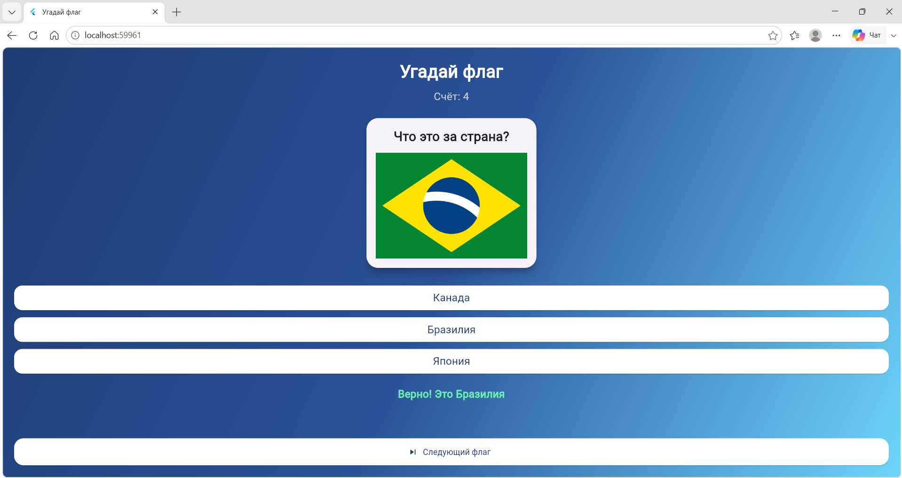

# Угадай флаг

Приложение-викторина: пользователю показывается флаг страны,
нужно выбрать правильное название из трёх вариантов. За верные ответы
начисляются очки.

## Автор

Трафимова Мария
Группа: ИСП-242

## Стек и версии

- Flutter 3.47.5
- Dart 3.13.4
- Платформа: Web (Edge)
- IDE: VS Code

## Скриншот



## Структура проекта

- `lib/main.dart` — точка входа, MaterialApp, отключён DEBUG-баннер
- `lib/data/flags_data.dart` — модель FlagItem и список флагов
- `lib/widgets/gradient_background.dart` — градиентный фон
- `lib/widgets/flag_card.dart` — карточка с изображением флага
- `lib/widgets/answer_buttons.dart` — кнопки вариантов ответа
- `lib/screens/quiz_screen.dart` — StatefulWidget: логика викторины, Random, setState

## Как запустить

```bash
git clone https://github.com/2mariia4/Flutter_Lab6.git
cd Flutter_Lab6
flutter pub get
flutter run -d chrome
```

## Что изучили

- Разбивка приложения на отдельные файлы и виджет-классы
- Передача данных в StatelessWidget через параметры конструктора
- Управление состоянием через StatefulWidget и setState()
- Работа с assets и подключение изображений через pubspec.yaml
- Использование Random из dart:math для случайного выбора
- Оформление проекта через Git и GitHub